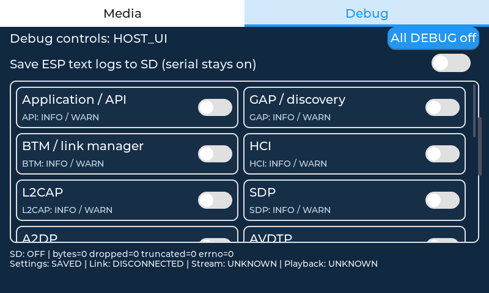
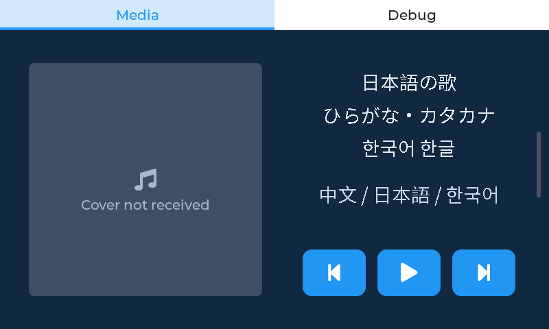

# 显示与 Media 验证记录

日期：2026-10-12。工作目录 `/home/yiyuan/share/esp32`，仅本机修改、测试与编译。
没有烧录、连接串口、操作手机或远端写入。

## 回归与审查

使用 search-first 复用官方 Board Manager amend、esp_lvgl_port RGB、GMF Cover Art、
LVGL widget/fallback 与 lv_font_conv；tdd-workflow 保留本地 RED 检查点：

- `0bc60dd`：低对比度、播放 glyph 不变、日韩缺字、清除封面无效、解码持 LVGL 锁。
- `189466e`：补充边界后复现多行歌名与歌手重叠。
- `94fb035`：透明 Debug 背景、SOF0 后恶意 APP 段逃逸。
- `35c9fa7`：真实 decoder 回归与很长 CJK 标题被裁切。

最终 `bash tests/test_ui.sh` 成功：17 项 UI 用例 + 真实 JPEG 集成用例。
native 编译的是实际 `bt_ui.c` 和锁定的真实 LVGL widget/theme/font；仅硬件、
RTOS 调度、蓝牙和 Debug 后端适配为 stand-ins。

- 实际 card 样式对比度 12.76:1，检查页面不透明。中/日假名/韩文/Jamo 字形可用，
  全部 11,172 个现代 Hangul 音节逐一检查通过。
- 命令成功立即切换 glyph、失败恢复、手机通知校正；三行混排与 70 个汉字长标题
  不重叠、不越出 name 容器。UTF-8 码点边界、截断与无效输入通过。
- 封面复制/清除、队列满、代次过期、解码途中切歌、失败后恢复、输入上限和畸形
  header 通过。fake decoder 用于锁/对象生命周期断言，不被当作真实 JPEG 证明。
- 另一个 target 直接编译官方 `esp_jpeg/jpeg_decoder.c` + external `tjpgd.c`，
  使用官方 7,561-byte、46×46 logo JPEG：真实解码、7,560 种逐字节截断、
  19-byte 恶意 APP skip 输入、恢复和清除通过。
- `UI_HOST_SANITIZERS=ON ASAN_OPTIONS=detect_leaks=0 bash tests/test_ui.sh` 成功，
  app 和 external decoder 用 ASan/UBSan 编译。永久 UI 的销毁/泄漏测试不在范围内；
  LVGL 自身未用 sanitizer 重编。本机 external tjpgd 的 64-bit size_t/input callback
  有原 SDK 类型 warning，未改第三方代码；此验证不是板上 ROM decoder 的证明。
- native gcov：新增 `bt_ui.c` 可执行行 78/87（89.66%），UTF-8 helper 100%；
  整个历史 UI 59.44%，不是全固件 80% 覆盖，未覆盖全部电话/LE/硬件分支。
- `bash tests/validate_demo.sh`、shell 语法和 `git diff --check` 通过，原 Debug
  policy/storage 核心合计行覆盖仍为 97.30%。
- 只读代码审查发现 JPEG 段逃逸及长文本裁切，修复后复审无 CRITICAL/HIGH/MEDIUM。

干净 native 测试目录：`/tmp/esp32-ui-host.vRilX9`；sanitizer 目录：
`/tmp/esp32-ui-host.XvO0E0`。临时目录可能被清理，需时重跑脚本。

## 原生界面预览（不是板端截图）

以下由真实 LVGL snapshot 渲染，只验证样式/字形/排版，不证明 LCD 抗撕裂效果。
Media 使用占位，未伪造手机专辑封面：

## ESP-IDF 构建

`DEMO_UI=1 ./scripts/build_demo.sh` 与 `./scripts/build_demo.sh` 均成功。
`esptool --chip esp32s31 image-info` 验证两者 chip ID=32、16MB/DIO/80MHz、
checksum 和 validation hash 有效。

| 模式 | 应用镜像 | 8MiB 分区剩余 | SHA256 |
| --- | --- | --- | --- |
| UI | 6,509,760 bytes / 0x6354c0 | 22% | `724a848a8a741956355bb46aa3aaaf463dc011a8a355d7964c9e095a6c397d73` |
| 无屏 | 2,976,528 bytes / 0x2d6b10 | 65% | `40bb5d9f2f32656e62b05499e98be9367b4feb1a0037eafe55c12e92d857a839` |

实际 `sdkconfig.ui`：Cover Art、GOEPC 开启；无屏配置 Cover Art 仍关闭。
实际生成 LCD 配置：`num_fbs=2`、`bounce_buffer_size_px=0`。
共享 Board Manager 硬件生成配置用于两种构建，无屏不引入 UI 或新增字库。
独立新 UI 配置的 defaults 加载规则沿用已有验证；本轮没有另做干净克隆构建。

锁定依赖保持：GMF v1.0 `efc94f51c22d3af68a6f2f654f0eec9d13a46cb3`、
Board Manager 0.7.3~1、esp_lvgl_port 2.9.0、LVGL 9.5.0。
未改 SDK、GMF 子模块、managed components 或锁文件。

原始本机日志在 `/tmp/esp32-{ui,headless}-build-20261012.log`、
`/tmp/esp32-ui-final-20261012.log`、`/tmp/esp32-ui-asan-final-20261012.log`、
`/tmp/esp32-validation-20261012.log`、`/tmp/esp32-ui-coverage-20261012.log`。
构建中的版本字符串可能含当时 RED commit 和 dirty；这是 app 元数据，不表示
GMF tag 发生变动。复现构建后镜像 hash 会随元数据变化。

## 尚未验证

LCD 物理撕裂/欠载、触摸、音频共存和长稳；荣耀 WinRT 与音乐 App 的实际
Cover Art 服务；普通/快速/同封面切歌、下载错误和重连恢复；S31 ROM JPEG 实际运行。
app generation 不能识别 GMF 在途旧图，UI 的 512KiB 限制不能约束 GMF 接收缓冲。
板端步骤见 [显示与 Media 指南](MEDIA_DISPLAY_GUIDE.md)。
